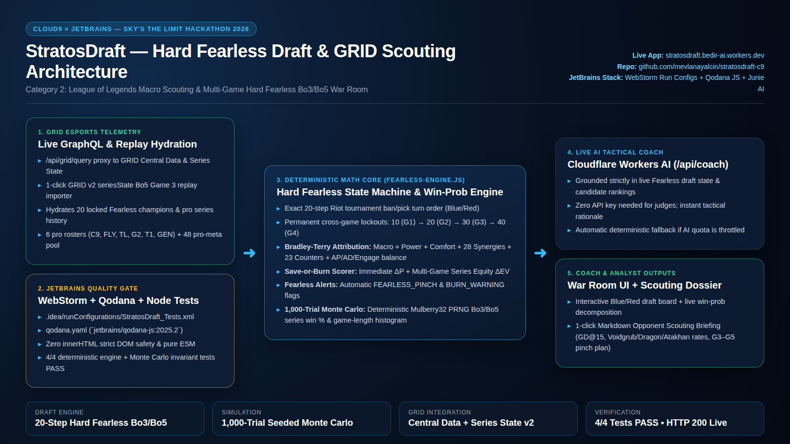

# Devpost Submission Package — Cloud9 × JetBrains "Sky's The Limit" Hackathon 2026

- **Project Name:** StratosDraft — Hard Fearless Draft & GRID Pro Scouting War Room
- **Tagline:** Official 20-step Riot Hard Fearless Bo3/Bo5 draft engine, Bradley-Terry + 1,000-trial seeded Monte Carlo win-probability model, live GRID GraphQL importer, and JetBrains Qodana-verified coaching workbench.
- **Category:** Category 2 — League of Legends Macro Scouting & Hard Fearless Draft (plus JetBrains AI-Powered Engineering Workflow)
- **Live Web Application:** https://stratosdraft.bedir-ai.workers.dev/
- **Live GRID Sample Series Endpoint:** https://stratosdraft.bedir-ai.workers.dev/api/grid/sample-series
- **Public GitHub Repository (MIT):** https://github.com/mevlanayalcin/stratosdraft-c9
- **Demo Video (<3 min, 1080p, 88.7s):** `/home/ubuntu/quick-cash-sprint/stratosdraft-media/stratosdraft-c9-demo-1080p.mp4` (ready for YouTube upload)

## Architecture

## What It Does
1. **Official 20-Step Hard Fearless Draft State Machine:** Enforces exact Riot tournament ban/pick order and permanent cross-game lockouts across Bo3/Bo5 series (10 locked after G1 → 20 after G2 → 30 after G3 → 40 after G4) for 48 pro-meta champions and 6 pro rosters (Cloud9, FlyQuest, Team Liquid, G2, T1, Gen.G).
2. **Bradley-Terry Win-Probability & Attribution:** Decomposes live Blue/Red win probability across Side/Macro baseline, Champion Power, Team Comfort, 28 Pairwise Synergies, 23 Directed Counters, and AP/AD/Engage balance.
3. **Save-or-Burn Recommender & 1,000-Trial Reproducible Monte Carlo Simulator:** Scores every legal ban/pick on immediate `ΔP` and multi-game Hard Fearless Series Equity `ΔEV`, raising `FEARLESS_PINCH` and `BURN_WARNING` alerts alongside a seeded Mulberry32 1,000-trial series win-probability & game-length histogram.
4. **Live GRID GraphQL & Replay Integration:** `/api/grid/query` proxy to GRID Central Data & Series State endpoints with BYOK `x-api-key`, plus 1-click GRID v2 `seriesState` Bo5 Game 3 replay hydration (`20` champions locked).
5. **Automated Scouting Dossier & Live AI Coach:** One-click Markdown Opponent Scouting Briefing plus live Cloudflare Workers AI tactical coach (`/api/coach`) grounded strictly in draft telemetry.

## JetBrains Tooling Integration
- **WebStorm / IntelliJ IDEA Run Configuration:** `.idea/runConfigurations/StratosDraft_Tests.xml` executes `node --test tests/fearless_engine.test.mjs` (`4/4` deterministic invariant tests PASS).
- **JetBrains Qodana Static Analysis:** `qodana.yaml` (`jetbrains/qodana-js:2025.2`, `qodana.recommended`) enforcing strict ESM hygiene and zero `innerHTML` DOM construction.
- **Workflow Story:** See [`JETBRAINS_WORKFLOW.md`](JETBRAINS_WORKFLOW.md).

## Disclaimer
StratosDraft is an independent open-source analytics tool built for the Cloud9 × JetBrains hackathon and is not affiliated with or endorsed by Riot Games.
